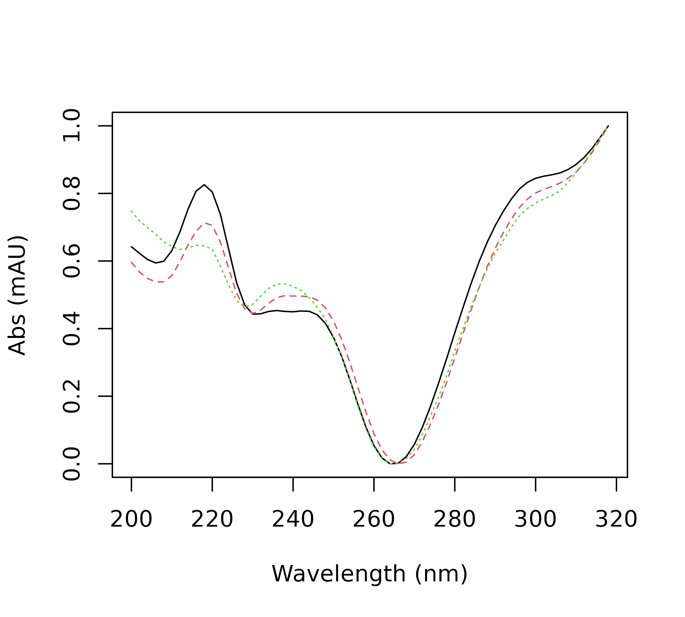
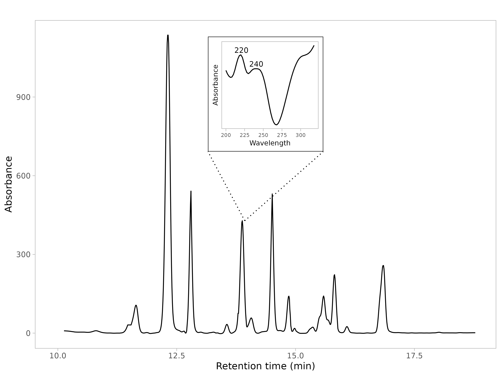
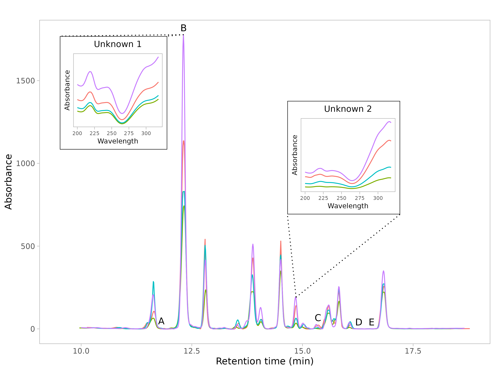
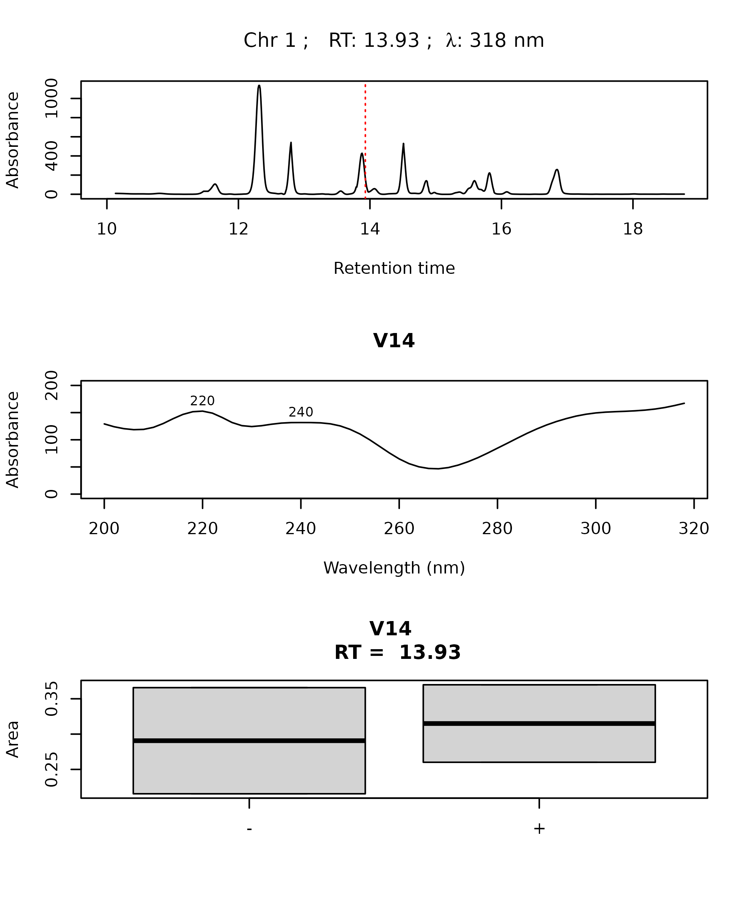

# chromatographR: An introduction to HPLC-DAD analysis

## Introduction

*chromatographR* is a package for the reproducible analysis of HPLC-DAD
data in `R`. Liquid chromatography coupled to diode-array detection
(HPLC-DAD) remains one of the most popular analytical methodologies due
to its convenience and low-cost. However, there are currently very few
open-source tools available for analyzing HPLC-DAD chromatograms or
other “simple” chromatographic data. *chromatographR* provides a
scriptable, open-source alternative to proprietary GUI-based software,
so an analysis can be exactly reproduced.

The *chromatographR* package began as a fork from the previously
published *alsace* package (Wehrens et al. 2015), but has been reworked
with improved functions for peak-finding, integration and peak table
generation as well as a number of new tools for data visualization and
downstream analysis. Unlike *alsace*, which emphasized multivariate
curve resolution through alternating least squares (MCR-ALS),
*chromatographR* is developed around a more conventional workflow that
should seem more familiar to users of standard software tools for
HPLC-DAD analysis. *chromatographR* includes tools for a)
pre-processing, b) retention-time alignment, c) peak-finding, d)
peak-integration and e) peak-table construction, as well as additional
functions useful for analyzing the resulting peak table.

## Workflow

### Loading data

chromatographR can import data from a growing list of proprietary file
formats using the `read_chroms` function from the chromConverter
package. Supported file formats include ‘Agilent ChemStation’ and
‘MassHunter’ (`.D`) files, ‘Thermo Raw’ (`.raw`), ‘Chromeleon’ UV ASCII
(`.txt`), ‘Waters ARW’ (`.arw`), ‘Shimadzu’ ASCII (`.txt`), and more.
(For a complete list, see the [chromConverter
documentation](https://ethanbass.github.io/chromConverter/)). Select the
appropriate file format by specifying the `format_in` argument (e.g.,
`csv`, `chemstation_uv`, `masshunter_dad`, `chromeleon_uv`,
`waters_arw`, etc).

``` text
> path <- 'foo' # path to parent directory
> 
> # single folder
> read_chroms(paths = path, format_in = "chemstation_uv")
> 
> # multiple folders
> folders <- list.files(path = path, full.names = TRUE)
> dat <- read_chroms(folders, format_in = "chemstation_uv")
```

### Example data

The package includes some example data consisting of root extracts from
tall goldenrod (*Solidago altissima*). Roots were extracted in 90%
methanol and run on an Agilent 1100 HPLC coupled to a DAD detector,
according to a previously described method (Uesugi and Kessler 2013).
The dataset is called `Sa` (abbreviated from *Solidago altissima*).

``` text
> data(Sa)
```

### Pre-processing data

Data from liquid chromatography often carry non-informative artifacts,
such as noise or a drifting baseline. The data may also have a higher
resolution or wider range (along either the time or spectral dimensions)
than we require. Smoothing reduces noise in the spectral direction, and
baseline subtraction corrects a drifting baseline. Interpolating
wavelengths and retention times reduces the dimensionality of the data,
which makes samples easier to compare and cuts the time and memory that
downstream analyses need. All three (smoothing, baseline correction, and
interpolation) are available through the `preprocess` function and are
enabled by default.

To select a narrower range of times and/or wavelengths, supply them to
the optional `dim1` and `dim2` arguments.

Several estimators are available for baseline correction. Here we focus
on the default estimator: asymmetric least squares (`"als"`, via
[`ptw::asysm`](https://rdrr.io/pkg/ptw/man/asysm.html) (Bloemberg et al.
2010)), which fits a smooth curve to the signal while weighting points
above the fit differently from points below it; the strength of that
asymmetry is set by `p` and the stiffness of the curve by `stiffness`.
Three other estimators are available – `"arpls"`, `"aspls"` and `"snip"`
– which differ in how they decide what counts as baseline (see
[`?baseline_estimators`](https://ethanbass.github.io/chromatographR/reference/baseline_estimators.md)
for further details).

The stiffness argument controls how rapidly the estimated baseline can
vary. Larger values produce a stiffer baseline that follows only slower
changes in the signal. The effective stiffness depends on the sampling
interval, so the same value can produce different baselines for
differently sampled data. Because baseline correction is applied after
interpolation, the effective `stiffness` is determined by the `dim1`
grid. Accordingly, the time grid should be chosen before tuning
stiffness.

``` text
> # choose dimensions for interpolation
> new_times <- seq(10, 18.66, by = .01) # choose time-points
> new_wavelengths <- seq(200, 318, by = 2) # choose wavelengths
```

Making the baseline too flexible is the failure mode to watch out for.
Below, the zoomed chromatogram is plotted with two estimated baselines.
At `stiffness = 1e3` the baseline bends up into the peak shoulders
around 12.5 and 13.8 minutes, and the signal it absorbs is subtracted
from the peaks above it. At 2e5, the baseline follows the drift while
remaining below the peak shoulders. There is no universally correct
value here: what works depends mostly on how sharply your own baseline
curves, which is why it is worth plotting the fit.

``` text
> i <- 2 # chromatogram number in list of data
> wavelength <- '200.00000' # this must match one of the column names from your chromatogram
> trace <- Sa[[i]][, wavelength, drop = FALSE]
> 
> fit_baseline <- function(stiffness){
+   preprocess(trace, dim1 = new_times, interpolate_cols = FALSE,
+              stiffness = stiffness, attach_baseline = TRUE,
+              show_progress = FALSE)
+ }
> too_flexible <- fit_baseline(1e3)
> about_right <- fit_baseline(2e5)
> 
> plot_baseline(too_flexible, lty=2, zoom = TRUE, annotate=FALSE, main="")
> plot_baseline(about_right, add=TRUE, col="darkgreen")
> legend("topright", c("stiffness = 1e3", "stiffness = 2e5"),
+        col = c("red", "darkgreen"), lty = c(2, 1), lwd = 2, bty = "n")
```


Estimated baselines on one wavelength of one chromatogram, plotted so
that only the baseline region is visible (the peaks run off the top of
the panel). At `stiffness = 1e3` (red, dashed) the baseline rides up
into the peak shoulders; at `2e5` (green) it follows only the drift.

The `stiffness` chosen above carries straight into the call below, which
applies it to the whole dataset on the same time grid. For 2D data
(e.g., from a single-wavelength detector), the `dim2` argument should be
left blank.

``` text
> dat.pr <- preprocess(Sa, dim1 = new_times, dim2 = new_wavelengths, 
+                      stiffness = 2e5, cl = 1)
```

### Alignment

In many cases, liquid chromatography can suffer from retention time
shifts of varying degree (e.g., due to temperature fluctuations, column
degradation, or subtle changes in mobile-phase composition), which can
make it very difficult to compare peaks across samples. Luckily, a
number of “time-warping” algorithms have been developed for correcting
these kinds of shifts. In `chromatographR`, the `correct_rt` function
offers three: parametric time warping (`ptw`) (Eilers 2004; Bloemberg et
al. 2010), variable penalty dynamic time warping (`vpdtw`) (Clifford et
al. 2009; Clifford and Stone 2012), and landmark parametric time warping
(`lptw`), which fits the warping polynomial to matched peak positions
rather than to the full signal. The two covered below are `ptw` and
`vpdtw`. Both warping functions aim to produce a better alignment of
features by “warping” the time-axis of each supplied chromatogram to
match a reference chromatogram. (The reference chromatogram can either
be determined algorithmically or selected manually by setting the
`reference` argument).

First, we check the alignment of our chromatograms using the
`plot_chroms` function.

``` text
> plot_chroms(dat.pr, lambdas = 210, show_legend = TRUE)
```


Chromatographic traces of four *S. altissima* root chromatograms at 210
nm.

Our chromatograms appear to be shifted, as shown by the poor overlap of
the chromatograms across our four samples. To remedy this problem, we
can try to “warp” our chromatograms using one of the two options
described above.

#### Parametric time warping

The `ptw` option can take a single wavelength or a list of wavelengths
provided by the user using the `lambdas` argument. For each
chromatogram, `ptw` then produces a “global” warping function across all
the wavelengths supplied by the user. The code block below creates
warping models for the samples in the provided list of data matrices.
The same function is then used to warp each chromatogram according to
the corresponding model, by setting the `models` parameter. Depending on
the variety of your samples and the severity of the retention time
shifts, it may take some experimentation with the warping parameters to
get satisfactory results. Fewer peaks can work better here: a wavelength
carrying fewer peaks sometimes yields a better warping model. (Also see
the documentation for [ptw](https://CRAN.R-project.org/package=ptw) for
more guidance on warp function optimization).

``` text
> warping.models <- correct_rt(dat.pr, alg = "ptw", what = "models", lambdas = 210, scale = TRUE)
> warp_ptw <- correct_rt(chrom_list = dat.pr, models = warping.models, what = "corrected.values")
```

We can then use the following code snippet to compare the alignment of
warped (top panel) and unwarped (bottom panel) chromatograms.

``` text
> par(mfrow=c(2,1))
> plot_chroms(dat.pr, lambdas = 210, show_legend = FALSE)
> legend("topleft", legend = "Raw data", bty = "n")
> 
> plot_chroms(warp_ptw, lambdas = 210, show_legend = FALSE)
> legend("topleft", legend = "PTW", bty = "n")
```


Comparison of parametric time warping (PTW) aligned chromatograms and
raw data.

Clearly, the alignment is considerably improved after warping. You can
also use the `correct_rt` function to do a global alignment on multiple
wavelengths, by providing a list of wavelengths to the `lambdas`
argument, but this will not always improve the results. While the
alignment still isn’t perfect after warping, it is probably good enough
to align our peaks and assemble them in the peak table, which is our
primary goal.

#### Variable penalty dynamic time warping

Variable penalty dynamic time warping is another algorithm that can be
very effective for correcting retention time shifts (Clifford et al.
2009; Clifford and Stone 2012). Instead of calculating an explicit
warping function, dynamic time warping (DTW) works by repeatedly
shifting, expanding or contracting the time axis in small steps until a
satisfactory alignment is attained. This process can result in very
close matching of peaks, but can also lead to severe peak distortion if
the time axis is repeatedly expanded and/or contracted (Tomasi et al.
2004). **Variable penalty dynamic time warping** is a derivative of DTW
that constrains expansion and contraction of the time-axis by applying a
penalty to these types of “risky” moves. This often places peaks very
closely, but it does not prevent distortion: a peak that falls where the
warp changes is still stretched or squeezed, and its area changes with
it (see *Peak detection and integration* below). Unlike `PTW`, `VPdtw`
can only take a single wavelength as input (but it returns a global
warping on the whole chromatographic matrix). The code snippet below
uses VPdtw to warp the example chromatograms using the first
chromatogram as a reference. The `penalty`, `max_shift` and
`dilation_span` parameters can be adjusted to control the degree of
warping. The latter two are widths along the time axis, given in
minutes.

(Note: `VPdtw` is a suggested rather than a required dependency, since
it needs a working C++ compiler.)

``` text
> vpdtw_models <- correct_rt(chrom_list = dat.pr, alg = "vpdtw", lambdas = 210,
+                            what = "models")
> warp_vpdtw <- correct_rt(chrom_list = dat.pr, models = vpdtw_models,
+                          alg = "vpdtw", lambdas = 210)
```

``` text
> par(mfrow=c(2,1))
> plot_chroms(dat.pr, lambdas = 210, show_legend = FALSE)
> legend("topleft", legend = "Raw data", bty = "n")
> 
> plot_chroms(warp_vpdtw, lambdas = 210, show_legend = FALSE)
> legend("topleft", legend = "VPdtw", bty = "n")
```


Comparison of variable penalty dynamic time warping (VPdtw) aligned
chromatograms (top) with raw data (bottom).

Chromatograms can also be visualized as heatmaps with
`plot_chroms_heatmap`, which can be a powerful way to check the
alignment of chromatograms across samples.

``` text
> par(mfrow=c(3,1))
> plot_chroms_heatmap(dat.pr, lambdas = 210, show_legend = FALSE,
+                     title="Raw data")
> plot_chroms_heatmap(warp_ptw, lambdas = 210, show_legend = FALSE,
+                     title="Parametric Time Warping (PTW)")
> plot_chroms_heatmap(warp_vpdtw, lambdas = 210, show_legend = FALSE,
+                     title="Variable Penalty Dynamic Time Warping (VPdtw)")
```


Heatmaps of the raw chromatograms (top), and of the chromatograms
aligned by parametric time warping (middle) and variable penalty dynamic
time warping (bottom).

In this case the alignments produced by the two algorithms are quite
similar, but in other cases one algorithm may dramatically outperform
the other. PTW’s parametric warp can occasionally go awry and overwarp
the data, distorting peaks. On the other hand, PTW fits an explicit
model to each chromatogram, and its coefficients often reveal
problematic samples.

### Peak detection and integration

The `get_peaks` function produces a nested list of peaks by looping
through the supplied chromatograms at the specified wavelengths, finding
peaks, and fitting them to the specified function using non-linear least
squares. The area under each fitted curve is then estimated by the
trapezoidal rule. The `fit` argument specifies the peak model. By
default, peaks are fit to an exponential-gaussian hybrid function
(`"egh"`) (Lan and Jorgenson 2001). The other models are the
bidirectional exponentially modified gaussian (`"bemg"`) and
`"gaussian"`. Alternatively, peak areas can be integrated without
applying a model (`fit = "raw"`). The function returns a nested list of
data.frames containing parameters for the peaks identified in each
chromatogram.

Integrate the unaligned chromatograms (`dat.pr`), not the warped ones.
Warping resamples the signal, so any peak it stretches or squeezes is no
longer the peak that was measured, and its area is wrong. Alignment is
still needed to decide which peaks are the same compound across samples;
`correct_peaks` supplies it by mapping each peak’s retention time
through the warping models, leaving areas untouched.

``` text
> # find and integrate peaks using bidirectional exponentially modified gaussian
> pks_bemg <- get_peaks(dat.pr, lambdas = c(210), fit = "bemg")
> 
> # find and integrate peaks using gaussian peak fitting
> pks_gauss <- get_peaks(dat.pr, lambdas = c(210), fit = "gaussian")
> 
> # find and integrate peaks using exponential-gaussian hybrid model
> pks_egh <- get_peaks(dat.pr, lambdas = c(210), fit = "egh")
> 
> # map retention times onto the aligned time axis
> pks_egh <- correct_peaks(pks_egh, mod_list = vpdtw_models, chrom_list = dat.pr)
```

#### Visualization

The `plot.peak_list` function shows how well the peaks were integrated.
Below we compare the peaks fitted for the first chromatogram (`idx = 1`)
using the three peak models. On these data, both asymmetric models fit
more closely than the symmetric gaussian, as the `r.squared` column of
each peak list shows.

``` text
> par(mfrow=c(3,1))
> plot(pks_gauss, idx = 1, lambda = 210)
> legend("topright", "Gaussian", bty = "n")
> 
> plot(pks_egh, idx = 1, lambda = 210)
> legend("topright", "Exponential-gaussian hybrid", bty = "n")
> 
> plot(pks_bemg, idx = 1, lambda = 210)
> legend("topright", "Bidirectional exponentially modified gaussian", bty = "n")
```


Comparison of peak models: gaussian (top), exponential-gaussian hybrid
(middle) and bidirectional exponentially modified gaussian (bottom).

#### Local baseline correction

When peaks sit on a rising or falling background — for example, during
gradient elution — the `baseline` argument fits a local baseline beneath
each peak. Setting `baseline = "flat"` fits a constant offset per peak;
`baseline = "sloped"` fits a linearly varying baseline across the peak
window. In both cases peak heights and areas are computed above the
fitted baseline.

The effect is most visible on data that has not been baseline-corrected
during preprocessing. Below, we preprocess the raw data without baseline
correction to better illustrate the difference.

``` text
> dat.pr.ubc <- preprocess(Sa[2], dim1 = new_times, dim2 = new_wavelengths,
+                         baseline = "none", cl = 1)
> 
> pks_ubc <- get_peaks(dat.pr.ubc, lambdas = 210, fit = "egh", cl = 1)
> pks_flat <- get_peaks(dat.pr.ubc, lambdas = 210, fit = "egh", baseline = "flat", cl = 1)
> pks_sloped <- get_peaks(dat.pr.ubc, lambdas = 210, fit = "egh", baseline = "sloped", cl = 1)
> 
> par(mfrow=c(3,1))
> plot(pks_ubc, lambda = 210)
> legend("topright", "Uncorrected", bty = "n")
> 
> plot(pks_flat, lambda = 210)
> legend("topright", "Flat baseline", bty = "n")
> 
> plot(pks_sloped, lambda = 210)
> legend("topright", "Sloped baseline", bty = "n")
```


Comparison of peak fitting with no baseline (top), a flat baseline
(middle), and a sloped baseline (bottom) on un-baseline-corrected data.
Shaded areas represent the fitted peak above the local baseline.

#### Peak filtering

The peak-finding algorithm often detects peaks that are little more than
noise. Filtering these out at this stage reduces the cost of peak table
construction, which matters most when there are many samples. Call
`filter_peaks` on the `peak_list` to filter by peak width (`min_fwhm`,
`max_fwhm`), height or area, or pass `min_amplitude` to `get_peaks` to
drop low apices before they are fitted.

To set the width limits, and the peak-finding settings, from the widths
of your own peaks, see the [peak-finding
article](https://ethanbass.github.io/chromatographR/articles/peak-finding.html).

### Peak table assembly

After obtaining a `peak_list`, the `get_peaktable` function links peaks
across samples by hierarchical clustering (complete linkage on retention
times, by default). It returns a `peak_table` object with samples as
rows and peaks as columns. The `peak_table` object also has slots for
holding metadata about peaks, samples, and the parameters used in the
analysis. With many samples this step is expensive, so filter the
`peak_list` before passing it to `get_peaktable` (see *Peak filtering*
above). Peaks can also be filtered after `peak_table` assembly using the
`filter_peaktable` function. An important parameter here is `hmax`, the
height at which the clustering tree is cut, which controls how closely
retention times must agree to be matched across samples. A low value of
`hmax` increases the odds of splitting a single peak across multiple
columns, while a high value increases the odds of combining multiple
peaks into the same column.

Because `pks_egh` carries corrected retention times, `get_peaktable`
clusters on those, and functions that later read spectra or traces from
the peak table use the aligned chromatograms automatically, rebuilt from
the warping models that `correct_peaks` stored.

``` text
> # assemble peak table from peak_list saved in `pks_egh`
> pk_tab <- get_peaktable(pks_egh, response = "area", hmax = 0.2)
> 
> # print first six columns of peak table
> head(pk_tab$tab[,1:6])
```

              V1       V2        V3        V4        V5        V6
    119 0.000000 5.433084 0.6104369 2.0632364 15.065750 0.3051644
    121 0.000000 4.183750 1.0255052 0.5964413  7.830246 0.0000000
    122 3.814608 8.343632 0.6042582 2.0559778 25.787379 1.7809250
    458 6.797762 6.311539 2.2515294 1.9966940 14.256253 1.2782027

If you only need a few known compounds, `get_peaks(targets = ...)` fits
only the peaks at the retention times you list, and `get_peaktable`
returns one named column per target. See
[`?targeted_analysis`](https://ethanbass.github.io/chromatographR/reference/targeted_analysis.md),
and the [targeted analysis
article](https://ethanbass.github.io/chromatographR/articles/targeted-analysis.html)
for a worked example.

### Further analysis and data-visualization

#### Attaching metadata

To begin analyzing your peak table, you will usually want to attach
sample metadata to the `peak_table` object. Use the `attach_metadata`
function. Its `metadata` argument takes a `data.frame` of experimental
metadata with one column matching your sample names; name that column as
a string in the `column` argument. The ordered metadata is stored in the
`sample_meta` slot of your peak table. The peak table can then be
normalized (e.g., by dividing out the sample weight) using the
`normalize_data` function.

``` text
> # load example metadata
> path <- system.file("extdata", "Sa_metadata.csv", package = "chromatographR")
> meta <- read.csv(path)
> # attach metadata
> pk_tab <- attach_metadata(peak_table = pk_tab, metadata = meta, column = "vial")
> # normalize peak table by sample mass
> pk_tab <- normalize_data(peak_table = pk_tab, column = "mass")
```

#### Attaching reference spectra

Optionally, attach scaled reference spectra to the `peak_table` with the
`attach_ref_spectra` function. This can be helpful for working with UV
spectra programmatically (e.g., to sort peaks by their chromophores).
Reference spectra are defined either as the spectrum with the highest
intensity for each peak (when `ref = "max.int"`) or as the spectrum with
the highest average correlation to the other spectra associated with the
peak (when `ref = "max.cor"`). Below we use these spectra to construct a
correlation matrix and find peaks matching a particular chromophore.

``` text
> pk_tab <- attach_ref_spectra(pk_tab, ref = "max.int")
> cor_matrix <- cor(pk_tab$ref_spectra)
> hx <- names(which(cor_matrix[,"V21"] > .97))
> matplot(x = as.numeric(rownames(pk_tab$ref_spectra)),
+                    y = pk_tab$ref_spectra[, hx], type = 'l',
+                    ylab = "Abs (mAU)", 
+                    xlab = "Wavelength (nm)")
```



#### Data visualization

##### Mirror plot

The `mirror_plot` function provides a quick way to visually compare
results across treatment groups.

``` text
> mirror_plot(pk_tab, lambdas = c(210), var = "trt", legend_size = 2)
```


##### Plotting spectra

The `plot_spectrum` function plots or returns the spectra associated
with a particular peak in your peak table – useful for checking whether
the spectra for a peak match across samples, or for comparing one
against a known standard. Set `plot_spectrum` or `plot_trace` to `FALSE`
to draw only the other. By default it plots the trace and spectrum from
the chromatogram with the largest peak in the peak table; `idx` and
`lambda` choose the chromatogram and wavelength instead.

``` text
> par(mfrow = c(2,1))
> peak <- "V8"
> plot_spectrum(peak, peak_table = pk_tab, chrom_list = warp_vpdtw,
+               verbose = FALSE)
```


The `plot_spectrum` function also generates interactive plots using
[plotly](https://plotly.com/r/).

``` text
> plot_spectrum(peak, peak_table = pk_tab, chrom_list = warp_vpdtw, 
+               verbose = FALSE, engine = "plotly")
```

The `plot_all_spectra` function compares the spectra for a specified
peak across all samples.

``` text
> par(mfrow=c(1,2))
> plot_all_spectra("V14", peak_table = pk_tab, export_spectrum = FALSE)
> plot_all_spectra("V15", peak_table = pk_tab, export_spectrum = FALSE)
```


Inconsistent spectra, as in `V14`, can indicate a problem with the
alignment, or co-elution of several substances in the same retention
window. By contrast, `V15` looks relatively pure.

The `plot_spectrum_inset` function plots spectra onto the chromatogram.

``` text
> plot_spectrum_inset("V14", peak_table = pk_tab, 
+               verbose = FALSE, xlab="Retention time (min)",
+               position="top", inset_width = 0.25)
```



Passing several peaks draws one inset per peak, titled by the names of
`loc`. Additional peaks can be labeled with arbitrary labels using the
`annotate_peaks` function.

``` text
> plot_spectrum_inset(c("Unknown 1" = "V8",
+                       "Unknown 2" = "V16"), idx=c(1:4), 
+                     peak_table = pk_tab, 
+               verbose = FALSE, xlab="Retention time (min)",
+               position=list(c(0.0,0.6),c(0.55,0.4)), inset_width = 0.25,
+               scale_spectrum = FALSE) |>
+    annotate_peaks(loc = c(A = "V6", B = "V8", C="V18",
+                           D = "V22", E = "V23"), peak_table = pk_tab)
```



##### Plot peak table function

The `plot.peak_table` function is a simplified interface to the plots
above: it dispatches to `plot_spectrum` and `plot_all_spectra`, and
compares results across treatments by calling `boxplot`.

``` text
> par(mfrow = c(3,1))
> plot(pk_tab, loc = "V14", box_plot = TRUE, vars = "trt", verbose = FALSE)
```



## References

Bloemberg, Tom G., Jan Gerretzen, Hans J. P. Wouters, et al. 2010.
“Improved Parametric Time Warping for Proteomics.” *Chemometrics and
Intelligent Laboratory Systems*, OMICS, vol. 104 (1): 65–74.
<https://doi.org/10.1016/j.chemolab.2010.04.008>.

Clifford, David, and Glenn Stone. 2012. “Variable Penalty Dynamic Time
Warping Code for Aligning Mass Spectrometry Chromatograms in R.”
*Journal of Statistical Software* 47 (April): 1–17.
<https://doi.org/10.18637/jss.v047.i08>.

Clifford, David, Glenn Stone, Ivan Montoliu, et al. 2009. “Alignment
Using Variable Penalty Dynamic Time Warping.” *Analytical Chemistry* 81
(3): 1000–1007. <https://doi.org/10.1021/ac802041e>.

Eilers, Paul H. C. 2004. “Parametric Time Warping.” *Analytical
Chemistry* 76 (2): 404–11. <https://doi.org/10.1021/ac034800e>.

Lan, Kevin, and James W. Jorgenson. 2001. “A Hybrid of Exponential and
Gaussian Functions as a Simple Model of Asymmetric Chromatographic
Peaks.” *Journal of Chromatography A* 915 (1): 1–13.
<https://doi.org/10.1016/S0021-9673(01)00594-5>.

Tomasi, Giorgio, Frans van den Berg, and Claus Andersson. 2004.
“Correlation Optimized Warping and Dynamic Time Warping as Preprocessing
Methods for Chromatographic Data.” *Journal of Chemometrics* 18 (5):
231–41. <https://doi.org/10.1002/cem.859>.

Uesugi, Akane, and André Kessler. 2013. “Herbivore Exclusion Drives the
Evolution of Plant Competitiveness via Increased Allelopathy.” *New
Phytologist* 198 (3): 916–24. <https://doi.org/10.1111/nph.12172>.

Wehrens, Ron, Elisabete Carvalho, and Paul D. Fraser. 2015. “Metabolite
Profiling in LC-DAD Using Multivariate Curve Resolution: The Alsace
Package for R.” *Metabolomics* 11 (1): 143–54.
<https://doi.org/10.1007/s11306-014-0683-5>.

## Session Information

``` text
> sessionInfo()
```

    R version 4.6.1 (2026-06-24)
    Platform: x86_64-pc-linux-gnu
    Running under: Ubuntu 24.04.5 LTS

    Matrix products: default
    BLAS:   /usr/lib/x86_64-linux-gnu/openblas-pthread/libblas.so.3 
    LAPACK: /usr/lib/x86_64-linux-gnu/openblas-pthread/libopenblasp-r0.3.26.so;  LAPACK version 3.12.0

    locale:
     [1] LC_CTYPE=C.UTF-8       LC_NUMERIC=C           LC_TIME=C.UTF-8       
     [4] LC_COLLATE=C.UTF-8     LC_MONETARY=C.UTF-8    LC_MESSAGES=C.UTF-8   
     [7] LC_PAPER=C.UTF-8       LC_NAME=C              LC_ADDRESS=C          
    [10] LC_TELEPHONE=C         LC_MEASUREMENT=C.UTF-8 LC_IDENTIFICATION=C   

    time zone: UTC
    tzcode source: system (glibc)

    attached base packages:
    [1] parallel  stats     graphics  grDevices utils     datasets  methods  
    [8] base     

    other attached packages:
    [1] chromatographR_0.9.0 knitr_1.52          

    loaded via a namespace (and not attached):
     [1] gtable_0.3.6          xfun_0.62             bslib_0.12.0         
     [4] ggplot2_4.0.3         htmlwidgets_1.6.4     caTools_1.18.4       
     [7] lattice_0.22-9        vctrs_0.7.3           tools_4.6.1          
    [10] bitops_1.1-0          generics_0.1.4        tibble_3.3.1         
    [13] pkgconfig_2.0.3       Matrix_1.7-5          data.table_1.18.6.1  
    [16] RColorBrewer_1.1-3    S7_0.2.2              desc_1.4.3           
    [19] readxl_1.6.0          lifecycle_1.0.5       compiler_4.6.1       
    [22] farver_2.1.2          stringr_1.6.0         ptw_1.9-17           
    [25] textshaping_1.0.5     RcppDE_0.1.9          minpack.lm_1.2-4     
    [28] htmltools_0.5.9       sass_0.4.10           yaml_2.3.12          
    [31] Formula_1.2-6         pillar_1.11.1         pkgdown_2.2.1.9000   
    [34] jquerylib_0.1.4       RaMS_1.4.3            cachem_1.1.0         
    [37] tidyselect_1.2.1      digest_0.6.39         stringi_1.8.9        
    [40] dplyr_1.2.1           purrr_1.2.2           labeling_0.4.3       
    [43] VPdtw_2.2.1           fastmap_1.2.0         grid_4.6.1           
    [46] cli_3.6.6             chromConverter_0.11.1 magrittr_2.0.5       
    [49] base64enc_0.1-6       dynamicTreeCut_1.63-1 withr_3.0.3          
    [52] scales_1.4.0          bit64_4.8.6           rmarkdown_2.32       
    [55] bit_4.6.0             otel_0.2.0            reticulate_1.47.0    
    [58] cellranger_1.1.0      fastcluster_1.3.0     ragg_1.5.2           
    [61] png_0.1-9             pbapply_1.7-5         evaluate_1.0.5       
    [64] rlang_1.3.0           Rcpp_1.1.2            glue_1.8.1           
    [67] xml2_1.6.0            jsonlite_2.0.0        R6_2.6.1             
    [70] systemfonts_1.3.2     fs_2.1.0             
