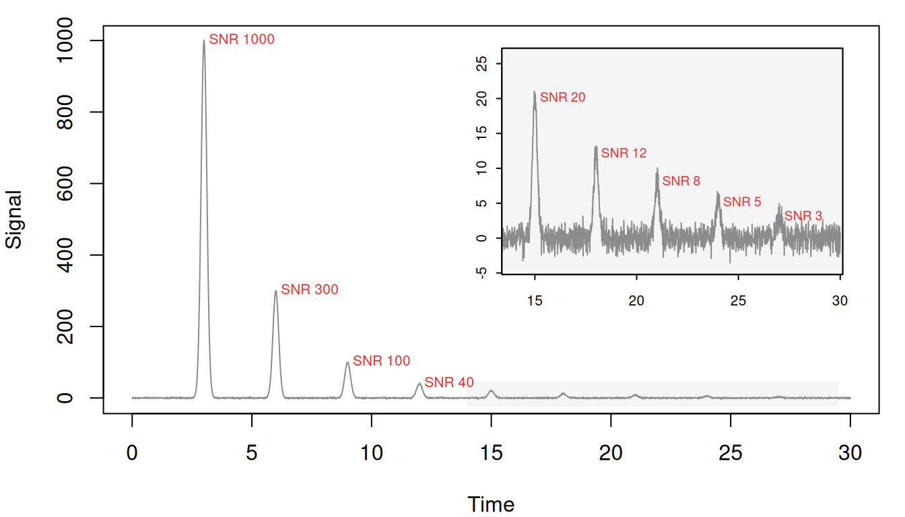
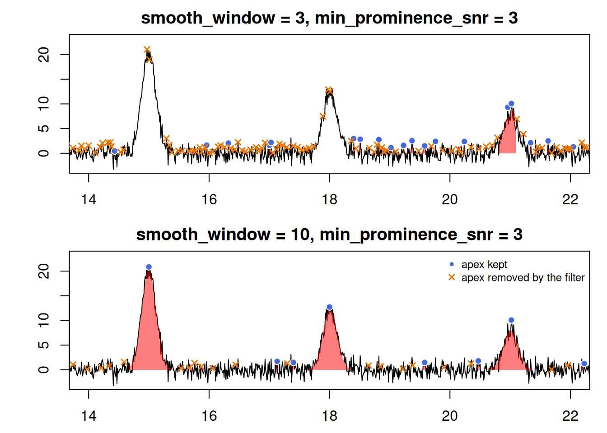
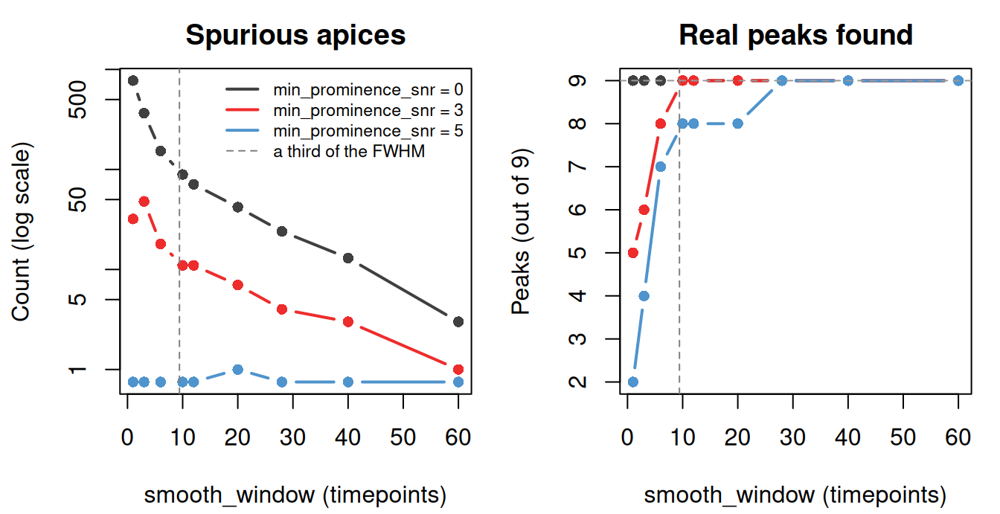
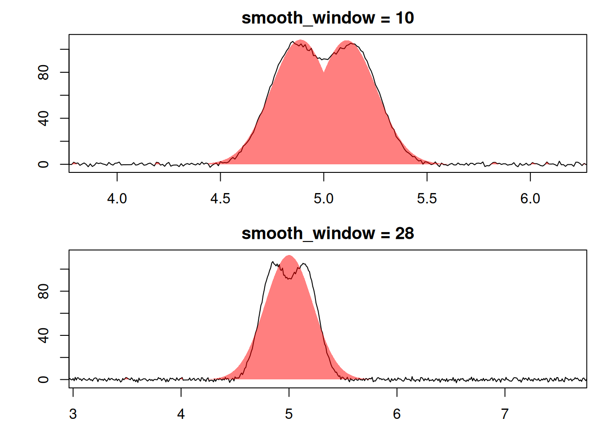

# Choosing peak-finding parameters

Peak finding in chromatographR places an apex wherever the first
derivative of the signal changes from positive to negative. Noise makes
the derivative change sign at every small wiggle, so
[`find_peaks()`](https://ethanbass.github.io/chromatographR/reference/find_peaks.md)
smooths the signal first; `smooth_window` sets the width of that
smoothing, in timepoints.

Three filters are available to remove small or spurious peaks:
`min_amplitude`, `min_curvature` and `min_prominence_snr`. The first two
are in the instrument’s units. The third discards apices that rise less
than that many noise standard deviations above the higher of the two
valleys beside them. All three default to `0`.

This article covers `smooth_window` and `min_prominence_snr`. The
prominence filter is the only one measured against the noise, so one
value can serve across datasets. It needs baseline-corrected data,
though:
[`find_peaks()`](https://ethanbass.github.io/chromatographR/reference/find_peaks.md)
estimates the noise from the timepoints outside peaks, and baseline
drift inflates that estimate. Too narrow a window can also make it
discard real peaks. See
[`find_peaks`](https://ethanbass.github.io/chromatographR/reference/find_peaks.md)
for the other two filters.

The recommended workflow is:

1.  Measure your peak widths.
2.  Set `smooth_window` to about a third of a typical width.
3.  Use
    [`filter_peaks()`](https://ethanbass.github.io/chromatographR/reference/filter_peaks.md)
    to remove detections narrower or wider than any real peak.

The sections below test that advice on simulated traces whose true peaks
are known, and the last applies it to the example data `Sa_pr`.

``` r

library(chromatographR)
```

## A trace with known peaks

The next three sections use a simulated trace: nine gaussian peaks, each
28 timepoints wide at half height, with heights from 1000 down to 3
against noise of standard deviation 1.

Simulate the trace

``` r

set.seed(1)
tt  <- seq(0, 30, by = 0.01)
ctr <- c(3, 6, 9, 12, 15, 18, 21, 24, 27)
hgt <- c(1000, 300, 100, 40, 20, 12, 8, 5, 3)
y   <- rep(0, length(tt))
for (i in seq_along(ctr)) {
  y <- y + hgt[i] * exp(-(tt - ctr[i])^2 / (2 * 0.12^2))
}
y <- y + rnorm(length(tt))

small <- hgt <= 20
zoom  <- list(x = c(14, 29.5), y = c(-4, 26))

par(mar = c(4, 4, 1, 1))
plot(tt, y, type = "n", xlab = "Time", ylab = "Signal")
rect(zoom$x[1], -25, zoom$x[2], 45, col = "grey96", border = NA)
lines(tt, y, col = "grey55")
text(ctr[!small], hgt[!small], paste("SNR", hgt[!small]), pos = 4,
     offset = 0.2, cex = 0.65, col = "firebrick2")

inset <- c(grconvertX(c(13.5, 30), "user", "ndc"),
           grconvertY(c(230, 1000), "user", "ndc"))
par(fig = inset, new = TRUE, mar = c(1.6, 1.8, 0.3, 0.3), cex.axis = 0.65,
    mgp = c(3, 0.4, 0), tcl = -0.2)
plot(tt, y, type = "n", xlim = zoom$x, ylim = zoom$y, xlab = "", ylab = "")
rect(par("usr")[1], par("usr")[3], par("usr")[2], par("usr")[4],
     col = "grey96", border = NA)
lines(tt, y, col = "grey55")
box()
text(ctr[small], hgt[small], paste("SNR", hgt[small]), pos = 4,
     offset = 0.2, cex = 0.6, col = "firebrick2")
```



The simulated trace, with each peak labelled by its signal-to-noise
ratio. The inset zooms in on the five smallest peaks, with heights of 20
down to 3, which sit close to the noise.

An apex counts as found when it lands within 0.05 of a true center, and
as spurious otherwise. The grid runs
[`find_peaks()`](https://ethanbass.github.io/chromatographR/reference/find_peaks.md)
at nine windows and three prominence thresholds:

Scoring function

``` r

score <- function(p, tol = 0.05){
  if (!nrow(p)) return(c(found = 0, spurious = 0))
  d <- tt[p$pos]
  c(found    = sum(vapply(ctr, function(c0) any(abs(d - c0) <= tol), logical(1))),
    spurious = sum(!vapply(d, function(x) any(abs(ctr - x) <= tol), logical(1))))
}
found_at    <- function(w, k) with(res, found[smooth_window == w & min_prominence_snr == k])
spurious_at <- function(w, k) with(res, spurious[smooth_window == w & min_prominence_snr == k])
first_all   <- function(k) with(res, min(smooth_window[min_prominence_snr == k & found == 9]))
```

``` r

windows <- c(1, 3, 6, 10, 12, 20, 28, 40, 60)
snrs    <- c(0, 3, 5)
grid    <- expand.grid(smooth_window = windows, min_prominence_snr = snrs)
scored  <- do.call(rbind, Map(function(w, k) {
  p <- find_peaks(y, smooth_window = w, min_prominence_snr = k)
  score(p)
}, grid$smooth_window, grid$min_prominence_snr))
res <- cbind(grid, scored)
```

The counts are plotted at the end of the next section. At the three
narrowest windows, which are under a third of the peak width,
[`find_peaks()`](https://ethanbass.github.io/chromatographR/reference/find_peaks.md)
also warns that the window is too narrow; those warnings are hidden on
this page.

## Narrow windows let noise through and split real peaks

Noise can split a small peak into several apices, each rising only a
little above the notch beside it, so `min_prominence_snr` discards the
pieces along with the noise and the peak is lost. To see this, wrap the
trace as a one-sample chromatogram and pass it to
[`get_peaks()`](https://ethanbass.github.io/chromatographR/reference/get_peaks.md)
at windows of 3 and 10 timepoints, with `min_prominence_snr = 3`:

``` r

sim <- list(sim = matrix(y, ncol = 1, dimnames = list(tt, "1")))
narrow <- lapply(c(3, 10), function(w)
  get_peaks(sim, lambdas = "1", fit = "gaussian", smooth_window = w,
            min_prominence_snr = 3, cl = 1, show_progress = FALSE))
```

Plot the fitted peaks and the apices

``` r

par(mfrow = c(2, 1), mar = c(2.5, 4, 2, 1))
for (i in 1:2) {
  w    <- c(3, 10)[i]
  all  <- find_peaks(y, smooth_window = w)$pos
  kept <- find_peaks(y, smooth_window = w, min_prominence_snr = 3)$pos
  gone <- setdiff(all, kept)
  plot(narrow[[i]], chrom_list = sim, xlim = c(14, 22), ylim = c(-3, 23),
       main = sprintf("smooth_window = %d, min_prominence_snr = 3", w))
  points(tt[kept], y[kept], pch = 21, cex = 1, bg = "royalblue", col = "white")
  points(tt[gone], y[gone], pch = 4, cex = 0.8, lwd = 1.5, col = "darkorange2")
}
legend("topright", c("apex kept", "apex removed by the filter"),
       pch = c(21, 4), pt.bg = c("royalblue", NA), col = c("white", "darkorange2"),
       pt.lwd = c(1, 1.5), bty = "n", cex = 0.75)
```



Peaks fitted between 14 and 22 minutes at windows of 3 (top) and 10
(bottom) timepoints, with `min_prominence_snr = 3`. Filled points mark
apices that pass the prominence filter, crosses those it removes.

Between 14 and 22 minutes the 3-timepoint window fits 1 of the three
peaks. Noise splits the SNR-20 peak into 2 apices and the SNR-12 peak
into 3, each rising at most 2.6 above the notch beside it. Every
fragment falls below the threshold of 3, so the filter removes them all
and nothing is left to fit. The 10-timepoint window keeps each summit in
one piece and fits all 3. At either window a few noise apices also clear
the threshold.

The same happens to every small peak on the trace. The table gives, for
each true peak, the number of apices within 0.05 of its center and the
largest of their prominences:

Prominence of the apices near each true peak

``` r

peak_prominence <- function(w){
  p <- find_peaks(y, smooth_window = w, bounds = TRUE)
  do.call(rbind, lapply(ctr, function(c0){
    near <- which(abs(tt[p$pos] - c0) <= 0.05)
    if (!length(near)) return(c(apices = 0, prominence = NA))
    c(apices = length(near), prominence = max(p$prominence[near]))
  }))
}
```

``` r

summits <- data.frame(height = hgt, w3 = peak_prominence(3),
                      w28 = peak_prominence(28))
summits
#>   height w3.apices w3.prominence w28.apices w28.prominence
#> 1   1000         1   1001.954703          1    1003.482275
#> 2    300         1    300.931797          1     301.835621
#> 3    100         1     99.267156          1     100.782965
#> 4     40         1     42.144718          1      39.891632
#> 5     20         2      2.556578          1      23.250991
#> 6     12         2      1.709688          1      14.758962
#> 7      8         2      3.426058          1       9.999787
#> 8      5         2      2.017186          1       7.530459
#> 9      3         2      3.262023          1       7.212463
```

The four tallest peaks keep one apex and their full prominence at either
window. At 3 timepoints the five small ones split in two, and their
prominence falls to between 1.7 and 3.4, against a noise level of
about 1. Height does not decide which of them survive: the SNR-3 peak
keeps a prominence of 3.3, while the SNR-12 peak falls to 1.7.

Across every window in the grid, the counts show the trade-off. Without
the prominence filter, spurious apices fall from 773 at a one-timepoint
window to 3 at 60, and all nine real peaks survive every window.

Plot the counts

``` r

cols <- c("grey25", "firebrick2", "steelblue3")
advised <- 2.355 * 0.12 / 0.01 / 3
spur <- matrix(res$spurious, nrow = length(windows))
fnd  <- matrix(res$found,    nrow = length(windows))

par(mfrow = c(1, 2), mar = c(4.2, 4.2, 2.4, 1))
matplot(windows, pmax(spur, 0.75), type = "b", log = "y", col = cols,
        pch = 16, lty = 1, lwd = 2,
        xlab = "smooth_window (timepoints)", ylab = "Count (log scale)",
        main = "Spurious apices")
abline(v = advised, lty = 2, col = "grey50")
legend("topright", c(paste("min_prominence_snr =", snrs), "a third of the FWHM"),
       col = c(cols, "grey50"), lwd = c(2, 2, 2, 1), lty = c(1, 1, 1, 2),
       bty = "n", cex = 0.72)
matplot(windows, fnd, type = "b", col = cols, pch = 16, lty = 1, lwd = 2,
        xlab = "smooth_window (timepoints)", ylab = "Peaks (out of 9)",
        main = "Real peaks found")
abline(v = advised, lty = 2, col = "grey50")
abline(h = 9, lty = 2, col = "grey60")
```



Spurious apices (left) and real peaks found (right) at each window, for
three prominence thresholds. The dashed vertical line marks the
recommended window, a third of the peak width. Zero counts are drawn at
0.75 so that they show on the log scale.

The filter removes spurious apices at any window, but at narrow windows
it removes real peaks too. At 3 timepoints, `min_prominence_snr = 3`
finds 6 of the nine and `= 5` finds 4. To keep all nine, `= 3` needs a
window of 10 timepoints and `= 5` needs 28. At 10 timepoints, about a
third of the peak width, `= 3` keeps all nine and cuts the spurious
apices from 89 to 11.

## Filtering the noise that remains

At the recommended window, `min_prominence_snr = 3` still leaves many
small noisy peaks among the real ones. These can be removed after
fitting using
[`filter_peaks()`](https://ethanbass.github.io/chromatographR/reference/filter_peaks.md)
using various criteria. The table below counts the fitted peaks that
each criterion retains, using the 10-timepoint peak table derived from
the 10-timepoint smoothing window:

Count the real and spurious fits

``` r

fit10 <- narrow[[2]]
count_fits <- function(p) {
  rt   <- data.frame(p[[1]][["1"]])$rt
  real <- vapply(rt, function(r) any(abs(ctr - r) <= 0.05), logical(1))
  setNames(c(sum(real), sum(!real)),
           c(sprintf("real (of %d)", length(ctr)), "spurious"))
}
fits10 <- data.frame(fit10[[1]][["1"]])
fits10$real <- vapply(fits10$rt, function(r) any(abs(ctr - r) <= 0.05), logical(1))
r2_fit10 <- fit10
r2_fit10[[1]][["1"]] <- fit10[[1]][["1"]][fits10$r.squared >= 0.8, ]
```

``` r

rbind(
  "none"                   = count_fits(fit10),
  "min_fwhm = 0.1"         = count_fits(filter_peaks(fit10, min_fwhm = 0.1)),
  "window_limited = FALSE" = count_fits(filter_peaks(fit10, window_limited = FALSE)),
  "min_height = 5"         = count_fits(filter_peaks(fit10, min_height = 5)),
  "converged = TRUE"       = count_fits(filter_peaks(fit10, converged = TRUE)),
  "r.squared >= 0.8"       = count_fits(r2_fit10)
)
#>                        real (of 9) spurious
#> none                             9       11
#> min_fwhm = 0.1                   9        0
#> window_limited = FALSE           9        6
#> min_height = 5                   8        1
#> converged = TRUE                 9       11
#> r.squared >= 0.8                 7        0
```

Width separates noise from peaks best. The spurious fits are at most
0.035 minutes wide and the real peaks at least 0.26, so `min_fwhm = 0.1`
removes all the noise and keeps all nine peaks. The other criteria do
worse:

- `window_limited = FALSE` removes only the fits pinned at one
  timepoint, the narrowest width a fit can report.
- `min_height` is in instrument units, and any cutoff that removes the
  noise here also removes the smallest real peak.
- An `r.squared` cutoff removes the noise but also the two smallest real
  peaks, whose fits are noisy.
- `converged` doesn’t separate them at all.

## Wide windows merge close peaks

A window that is too narrow fills the peak list with noise, which is
easy to see. A window that is too wide can merge neighboring peaks with
no warning. In the figure below, two overlapping peaks are shown whose
apices sit 0.30 minutes apart (about one peak width).

Simulate the pair and fit it

``` r

set.seed(1)
t2 <- seq(0, 10, by = 0.01)
y2 <- 100 * exp(-(t2 - 4.85)^2 / (2 * 0.12^2)) +
      100 * exp(-(t2 - 5.15)^2 / (2 * 0.12^2)) + rnorm(length(t2))
m2 <- matrix(y2, ncol = 1, dimnames = list(t2, "210"))

tidy_fit <- function(w) {
  fp   <- fit_peaks(m2, lambda = "210", smooth_window = w, fit = "gaussian")
  near <- fp[abs(fp$rt - 500) < 60 & fp$height > 50, ]
  data.frame(smooth_window = w, peaks = nrow(near), widest_FWHM = round(max(near$FWHM)),
             lowest_r.squared = round(min(near$r.squared), 2))
}
```

Fit and plot the pair at both windows

``` r

pair <- list(pair = matrix(y2, ncol = 1, dimnames = list(t2, "1")))
par(mfrow = c(2, 1), mar = c(2.5, 4, 2, 1))
for (w in c(10, 28)) {
  pks_pair <- get_peaks(pair, lambdas = "1", fit = "gaussian",
                        smooth_window = w, cl = 1, show_progress = FALSE)
  plot(pks_pair, chrom_list = pair, targets = 5, tol = 0.4,
       main = paste("smooth_window =", w))
}
```



Two peaks 0.30 apart, fitted at windows of 10 (top) and 28 (bottom)
timepoints.

With a 10-point smoothing window, the two fitted shapes follow the
trace. With a 28-point smoothing window, a single broad shape is fitted
to the whole region, missing both summits. The fitted values show the
same thing, at two more window sizes. Each row gives the number of
fitted peaks that are at least half the true height, the widest of their
FWHMs (each true peak is 28 timepoints wide), and the lowest
`r.squared`:

``` r

merged <- do.call(rbind, lapply(c(3, 10, 28, 40), tidy_fit))
merged
#>   smooth_window peaks widest_FWHM lowest_r.squared
#> 1             3     2          34             0.99
#> 2            10     2          34             0.99
#> 3            28     1          52             0.96
#> 4            40     1          52             0.96
```

Windows of 3 and 10 fit both peaks. At windows of 28 and 40,
[`fit_peaks()`](https://ethanbass.github.io/chromatographR/reference/fit_peaks.md)
reports one peak where there are two. The fit still looks good, with an
`r.squared` of 0.96, but its `FWHM` of 52 timepoints is nearly twice the
true width of 28.

## Application to real data

``` r

data(Sa_pr)
pks    <- get_peaks(Sa_pr, lambdas = 210, cl = 1, show_progress = FALSE)
widths <- do.call(rbind, lapply(pks, function(x) data.frame(x[["210"]])))
dt     <- get_time_resolution(Sa_pr, unit = "min")
median(widths$FWHM, na.rm = TRUE) / dt
#> [1] 6.068966
```

`FWHM` is in minutes but `smooth_window` counts timepoints, so the last
line divides by the sampling interval: a typical `Sa_pr` peak spans 6
timepoints, which puts `smooth_window` at about 2. Real widths are messy
at both ends (here the narrowest detections are one-timepoint noise fits
and the widest are low, broad humps), so plot the extremes before
setting `min_fwhm` and `max_fwhm`, and don’t take them from quantiles.
