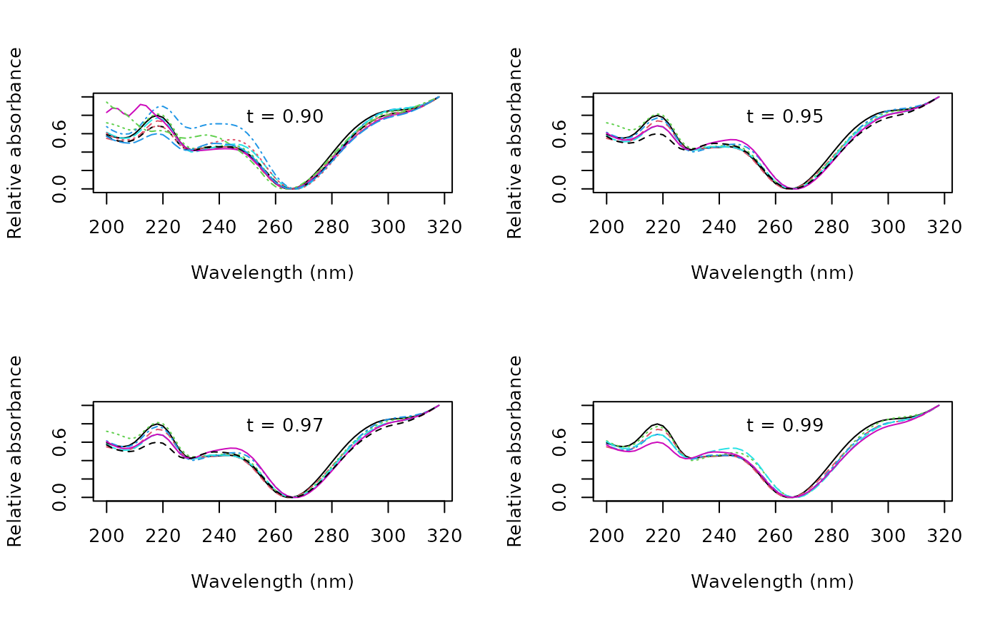
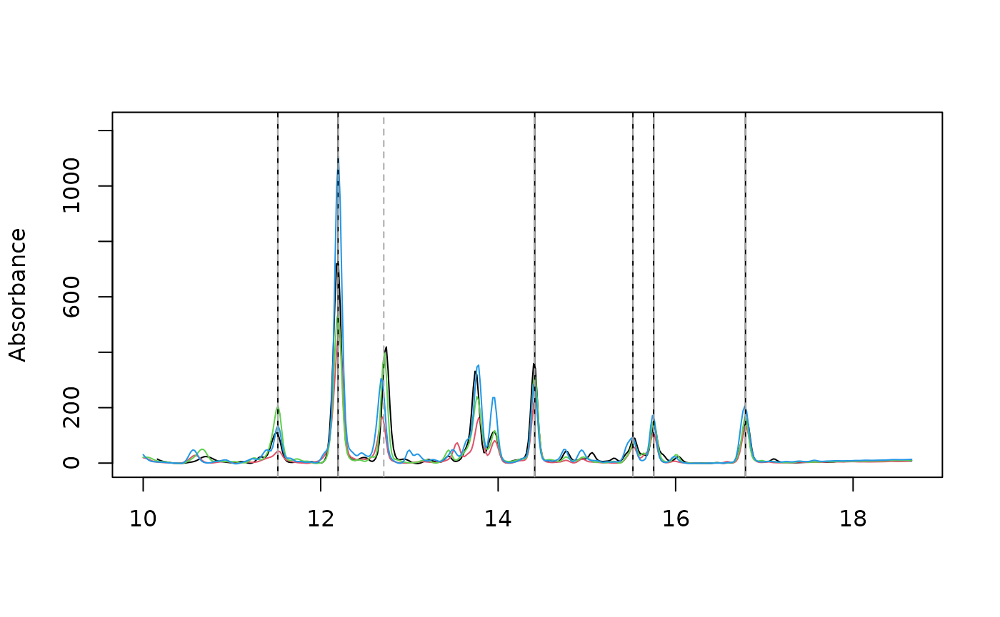
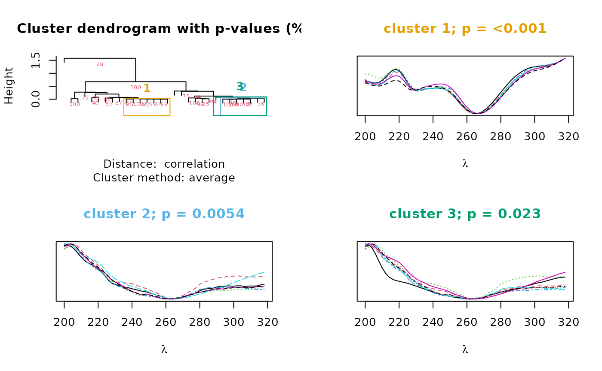

# Programmatic analysis of UV spectra

Compounds that share a chromophore have similar UV spectra, so the
spectra in a peak table can group peaks by compound class. This article
shows two ways to do it: correlation with the spectrum of a chosen peak,
and hierarchical clustering of all the spectra.

``` r

library(chromatographR)
data("Sa_warp")
```

``` r

pks <- get_peaks(Sa_warp, lambdas = 210)
pktab <- get_peaktable(pks)
```

``` r

pktab <- attach_ref_spectra(pktab, ref = "max.cor")
```

After assigning reference spectra to our peak table, we can use Pearson
correlations to locate peaks within a chosen similarity threshold of a
reference spectrum. To do this, we first construct a correlation matrix
using the `cor` function.

##### Analysis of spectral correlations

``` r

cor_mat <- cor(pktab$ref_spectra)
```

We can then plot spectra falling within a desired similarity threshold
(`t`) to a reference peak (in this case `V18`).

``` r

ref <- "V18"
wl <- as.numeric(rownames(pktab$ref_spectra))
par(mfrow=c(2,2))
idx_90 <- which(cor_mat[,ref] > .9)
matplot(wl, pktab$ref_spectra[,idx_90], type='l',
        xlab="Wavelength (nm)", ylab="Relative absorbance")
legend("top", "t = 0.90", bty = "n")

idx_95 <- which(cor_mat[,ref] > .95)
matplot(wl, pktab$ref_spectra[,idx_95], type='l',
        xlab="Wavelength (nm)", ylab="Relative absorbance")
legend("top", "t = 0.95", bty = "n")

idx_97 <- which(cor_mat[,ref] > .97)
matplot(wl, pktab$ref_spectra[,idx_97], type='l',
        xlab="Wavelength (nm)", ylab="Relative absorbance")
legend("top", "t = 0.97", bty = "n")

idx_99 <- which(cor_mat[,ref] > .99)
matplot(wl, pktab$ref_spectra[,idx_99], type='l',
        xlab="Wavelength (nm)", ylab="Relative absorbance")
legend("top", "t = 0.99", bty = "n")
```



We can also extract retention times for spectra above the desired
spectral similarity threshold with the reference spectra.

``` r

rts_99 = pktab$pk_meta["rt", idx_99]
rts_99
#>          V4       V6      V14     V18      V19     V23
#> rt 11.51706 12.19639 14.41222 15.5188 15.75304 16.7874
```

Below we plot traces of our four chromatograms at 210 nm. The 6 peaks
that match the reference spectrum at the 99% level are marked with solid
black lines and the 7 peaks that match the reference spectrum at the 97%
level are marked with dotted gray lines.

``` r

par(mfrow = c(1, 1))
plot_chroms(Sa_warp, lambdas=210)

abline(v = rts_99)
abline(v = pktab$pk_meta["rt", idx_97], lty=2, col = "darkgray")
```



If we are interested in the combined area of these peaks, we could also
use these indices to sum them together.

``` r

rowSums(pktab$tab[, idx_99, drop = FALSE])
#>      119      121      122      458 
#> 175.8716 121.1417 155.2266 207.1897
```

##### Hierarchical clustering of spectra

`chromatographR` also includes a function (`cluster_spectra`) to group
spectra using hierarchical clustering. We can set the seed with the
`iseed` argument to ensure repeatability among instantiations of this
vignette. Clusters of 20 or more peaks span most of the table and say
little about any one chromophore, so we drop them with `max_size`.

``` r

par(mfrow=c(2,2))
cl <- cluster_spectra(pktab, alpha = 0.05, max_size = 20, iseed = 1)
```



The output is a dendrogram of peaks, annotated with bootstrap values
(cluster support estimated by resampling) at each node. It also plots
the spectra of clusters whose bootstrap p-value falls below the
significance level specified by `alpha`. In this case, we recovered 3
clusters. We can find the cluster containing our reference peak and
access its peaks as follows:

``` r

ref_cl <- Filter(function(k) ref %in% k@peaks, cl$clusters)[[1]]
ref_cl@peaks
#> [1] "V4"  "V6"  "V8"  "V14" "V18" "V19" "V23"
```

This cluster holds the same peaks that correlate with V18 above 0.95:

``` r

setequal(ref_cl@peaks, names(idx_95))
#> [1] TRUE
```

##### Choosing an approach

A correlation threshold needs a reference peak and a cutoff, and returns
the peaks whose spectra resemble that one. Clustering needs no reference
peak: it groups the spectra of the whole table and estimates the support
for each group by bootstrapping, though you still choose `alpha` and
`max_size`. Here both found the same 7 peaks. Use a threshold when you
know which compound you are looking for, and clustering to see which
groups of spectra the table contains.
